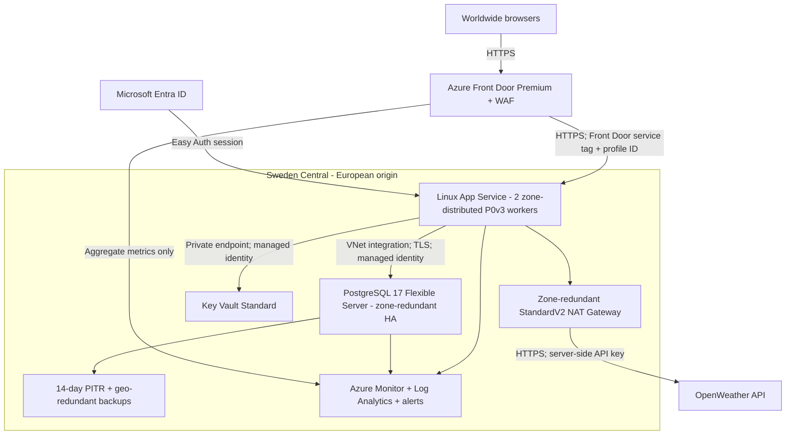

# SkyCast Azure infrastructure

## Status and scope

Infrastructure provisioning has succeeded in `weatherdemo-rg` in Sweden Central,
including App Service, Front Door, Key Vault and private PostgreSQL 17 with
zone-redundant HA. Application publishing, private database initialization and
authenticated cloud acceptance are not yet complete. Entra identities have
been configured separately. Provisioned resources now incur Azure charges.
Local development and the Docker database remain unchanged.

The templates provision infrastructure, authentication configuration and runtime
settings. Application ZIP deployment, Entra registration setup and the private
database bootstrap are separate release steps below. A successful Bicep build
is not proof that Azure has capacity, that secrets are valid, or that the live
application works.

## Architecture

### Client requirements and release acceptance

| Requirement | Implementation | Verification / remaining acceptance |
| --- | --- | --- |
| European hosting and competitive pricing | Sweden Central for regional resources; configurable European alternatives | P0v3 is offered and PostgreSQL HA/geo-backup capabilities were returned for this subscription. Current complete regional price comparison is still required; cheapest-region status is not proven. |
| Global access and latency | Front Door global edge, TLS and Microsoft backbone to the European origin | Dynamic responses are deliberately not edge-cached. Measure latency from representative countries; one European origin cannot promise minimum latency everywhere. |
| Prefer PaaS | App Service, managed PostgreSQL, Key Vault, Front Door and Azure Monitor | Hosted CI runs private bootstrap in a temporary App Service sharing existing capacity; no runner VM is needed. |
| API, operations and PostgreSQL storage | Server-side OpenWeather calls, per-user preference/activity persistence and private database connectivity | Local tests cover application/storage behavior. Authenticated cloud save/read/delete and user isolation must pass after deployment. |
| Cost/benefit | Two minimum web workers, bounded autoscale, managed services and bounded logging | HA database and Premium WAF have material fixed cost. Approve total monthly estimate and add a subscription budget/alerts; autoscale limits are not a spending cap. |
| Privacy | Tenant/guest authentication, non-admin runtime identity, TLS, private DB/vault, no personal-response edge caching, data erasure and restricted logging | Confirm customer onboarding, contractual residency, retention/backup erasure process and secret rotation. No automatic GDPR compliance claim. |
| High availability | Zone-redundant web plan and PostgreSQL standby, health probes, alerts and backups | Perform failover and restore drills and agree RTO/RPO. Cross-region automatic failover and zero-downtime release slots are not configured. |

Initial deployment is not production acceptance. An application owner manually
registers the final sign-in callback; CI has no Graph permissions or sign-in app
ownership. Neither a complete secret-name list nor a passing Bicep build proves
customer sign-in or persistence. Never enable public database access, bypass
production approval, or silently reduce HA to force a release through.

The developer's API key has appeared in shared editor/chat context. Rotate it
at the provider before production and replace both the local value and GitHub
secret without posting the replacement into chat.



The App Service public origin only accepts the `AzureFrontDoor.Backend` service
tag **and this profile's** `X-Azure-FDID`. The header alone is not trusted.
Other Front Door profiles and direct browser traffic are denied. Front Door
Premium Private Link would additionally remove public origin ingress; that is
not configured here. The SCM/release endpoint has a separate single-IP `/32`
allow rule and requires Entra authorization; FTP/basic publishing are disabled.

### Component choices and client requirements

| Component | Selected option | Rationale / trade-off |
| --- | --- | --- |
| Origin region | Sweden Central | European region with availability zones and the selected services; lowest compute subtotal in our earlier representative European comparison. North/West Europe are allowed alternatives. This is not a universal cheapest-region guarantee. |
| Global ingress | Front Door **Premium** | Anycast edge entry, TLS termination and Microsoft backbone acceleration; managed default/bot WAF rules in Prevention mode justify the higher fixed cost for the security requirement. |
| Web compute | Linux App Service **P0v3**, 2 workers | Managed Python hosting rather than VMs/Kubernetes; zone distribution, Always On and health checks. CPU autoscale adds up to 2 workers above the configured minimum. |
| Database | PostgreSQL Flexible Server **General Purpose D2ds_v5**, version 17 | Small HA-capable general-purpose SKU; a separate synchronous standby in another zone. Burstable is cheaper but not an HA replacement. |
| Recovery | 14-day point-in-time restore, geo-backup | Recovery from accidental changes and regional disaster. Backup restore is not instant regional failover. Geo-backup availability must be checked before creation. |
| Private network | VNet, delegated app/database subnets, private DNS, database NSG | PostgreSQL has no public access; only app/admin subnets and database HA traffic can reach port 5432. Key Vault uses a private endpoint. |
| Outbound networking | **StandardV2** NAT + static public IP | Explicit outbound access and zone-resilient egress for API/identity calls; avoids making a zonal NAT the weak link in an HA design. |
| Secrets | Key Vault **Standard**, RBAC, purge protection | No API keys or sign-in secrets in source/output. Managed identity reads versionless Key Vault references; review/rotate credentials regularly. |
| Database authentication | Managed identity / Entra tokens | No database password in the app. A human administrator group bootstraps a non-admin application role with permissions scoped to the dedicated database. |
| Customer sign-in | App Service Easy Auth + Entra web registration | Avoids implementing passwords/session validation in Flask. Anonymous weather search remains available; saved data requires authentication in the backend. |
| Monitoring | Log Analytics, 30-day retention, 1 GB/day ingestion cap; metric alerts | CPU-driven scaling; alerts for HTTP 5xx, database CPU and storage pressure, with an email destination. HTTP/query/body logs are deliberately not exported. |

Premium is the default, not the cheapest possible configuration. Setting
`frontDoorSku = 'Standard_AzureFrontDoor'` removes the managed WAF rule sets;
the custom API rate-limit rule still applies. This is an explicit security
downgrade, not an equivalent production profile. HA is not silently disabled
for the `test` environment label.

### Pricing and availability

The prior comparison of **2 x Linux P0v3 plus 2 x D2ds_v5 database compute**
was approximately USD 402.96/month in Sweden Central, 411.72 in North Europe
and 439 in West Europe (730 hours; indicative retail rates observed earlier
in this exercise). These are **compute subtotals, not total solution costs**.

The latest retail-price refresh was rate-limited, so those figures were not
revalidated while authoring these files. Before approving deployment, price:
Front Door Premium/WAF, requests and transfer, PostgreSQL storage/backup/HA
storage, NAT/public IP and traffic processing, private endpoints, DNS, logs
and alerts. Add taxes and any account-specific pricing. Premium Front Door
is a significant fixed cost. Consider reservations only after measuring steady
usage. App autoscale is bounded, but this is not a spending cap.

Confirm P0v3 availability, zone redundancy, D2ds_v5 vCPU quota, PostgreSQL
zones 1/2, geo-backup, StandardV2 NAT/public IP support, resource-provider
registration and Azure Policy in the actual subscription. Do not silently
fall back to a single-zone database or one web instance if a check fails.

### Availability boundaries

- Zone-level faults: multiple web workers and database HA reduce impact; there
  may still be connection drops and failover interruption. The pool recycles
  connections; a failed in-flight operation can return 503 rather than silently
  claiming success.
- `/healthz` is intentionally liveness-only: database failure must not remove
  weather-only web instances from service. Monitor saved-data failures using
  HTTP 5xx alerts and database metrics.
- Region failure: this is a **single-region** deployment. Geo-backup supports
  recovery, not automatic cross-region application failover. Define an RTO/RPO,
  rehearse restores, and add a second EU web region plus database DR if the
  client's recovery targets require it. No zero-downtime or 100% uptime claim.
- OpenWeather and Entra are external dependencies. WAF limits are per source IP,
  not a global provider-quota guarantee; users behind shared NAT can be affected.
  The app's weather cache is per process, not a shared multi-instance cache.

## Privacy and security boundaries

- Database rows, saved forecasts and Key Vault secrets originate in Europe.
  Geo-backups use Azure's supported paired-region arrangement; verify the exact
  destination and contractual residency requirements before enabling them.
- **Front Door is a global service**: connections and requests are processed at
  worldwide edges. Entra, alert email delivery and OpenWeather have their own
  processing/residency policies. This is not a promise of EU-only end-to-end
  processing or automatic GDPR compliance.
- Front Door caching is disabled on the entire route, including `/.auth/*` and
  personal APIs. This protects sessions but does not eliminate origin latency.
  Public static caching can be added later with a carefully separated route.
- App HTTP logs, detailed error pages and failed-request traces are disabled.
  Front Door access/WAF request logs and SQL statement logs are not exported;
  metrics and App Service platform logs are collected instead. This sacrifices
  some incident forensics. If request logs are later enabled, review their IP,
  URL, cookie and header content, retention, RBAC and user notice first.
- The application stores minimal identity/preferences/activity, not search
  history. Erasure deletes live application rows; backups expire on their
  retention schedule. Restores must replay any erasure requests made afterward.
- The existing application's 90-day activity cutoff is enforced on startup
  and writes, **not by an independent daily purge service**. Inactive-user
  records can remain longer until cleanup runs. A hard retention SLA requires
  an independently tested scheduled purge before production and corresponding
  privacy-notice wording; these templates do not invent such a guarantee.
- The runtime role may create/own tables only in the dedicated database's
  public schema because the current app initializes its schema lazily.
  It is not a server administrator. Separate migration identity and runtime
  DML-only permissions would require changing the application's initializer.
- The chosen Entra configuration is one tenant. Invite external customers as
  B2B guests and enforce MFA/Conditional Access as appropriate. Unrestricted
  consumer self-sign-up needs an Entra External ID customer tenant and a
  separately validated issuer/sign-in configuration; it is not enabled here.

## Files and local validation

- `main.bicep`: resource-group entry point and secure parameters.
- `network.bicep`: explicit egress, VNet/subnets, NSG and private DNS.
- `web.bicep`: App Service, identity, settings, Easy Auth and log settings.
- `edge.bicep`: global route, probes and WAF association.
- `operations.bicep`: autoscale, action group and metric alerts.
- `main.bicepparam`: environment-variable parameter example; no secrets stored.
- `bootstrap-database.sql`: Entra-role mapping and database-scoped grants.
- `validate.ps1`: compile templates/parameters using dummy secrets and run
  compiled-ARM contract tests; no Azure login or deployment.

From the project root, with Bicep CLI on PATH and the existing Python environment:

```powershell
.\infra\validate.ps1
```

Alternatively pass `-BicepCommand 'C:\tools\bicep.exe'`. Module versions are
pinned and AVM telemetry is disabled. The PostgreSQL AVM is deliberately pinned
to 0.13.0, which uses a stable 2024-08-01 server API; the newer inspected
releases used preview APIs. Native child resources are used for Easy Auth,
log settings, autoscale and edge routing where a separate module is unavailable
or splitting the profile/site dependency is necessary.

Static validation does not test Azure DNS resolution, Entra tokens, Key Vault
references, email delivery, PostgreSQL bootstrap or live failover.

## Future deployment runbook - do not run until approved

For automated releases, use the [GitHub Actions setup](#github-actions-cicd)
below instead of performing these steps manually.

1. Select and sign in to the intended Azure subscription/tenant. Install Azure
   CLI and Bicep if absent. Check the policies, quotas, prices and regions above.
   Create the dedicated resource group in the chosen EU region.
2. Create an Entra **Web** app registration in that tenant and a service
   principal. Enable ID token issuance for Easy Auth's hybrid sign-in flow.
   Create a client secret with an expiry/rotation owner. Create/select the
   database administrator security group and assign trusted operators only.
3. Populate the environment variables referenced by `main.bicepparam`:
   `AZURE_TENANT_ID`, `ENTRA_CLIENT_ID`, `ENTRA_CLIENT_SECRET`,
   `OPENWEATHER_API_KEY`, `DATABASE_ADMIN_GROUP_OBJECT_ID`,
   `DATABASE_ADMIN_GROUP_NAME`, `ALERT_EMAIL`.
   Use a password manager/secure interactive prompt, never commit a populated
   parameters file.
   The deployment identity needs resource deployment and RBAC-assignment
   permissions. Entra registration administration is a separate permission.
4. Validate and review a preview against the **existing** resource group:

   ```powershell
   az deployment group validate --resource-group $resourceGroup --parameters .\infra\main.bicepparam
   az deployment group what-if --resource-group $resourceGroup --parameters .\infra\main.bicepparam
   ```

   If either command fails, stop and resolve it. With subsequent explicit approval:

   ```powershell
   az deployment group create --name weather-infra --resource-group $resourceGroup --parameters .\infra\main.bicepparam
   ```

   The `.bicepparam` `using` statement supplies the template. Avoid `--debug`,
   shell transcription and saving expanded parameter JSON containing secrets.
5. Add the output `entraRedirectUri` to the registration's Web redirect URIs.
   Use only the Front Door URL for customer access. Confirm the real secret
   references resolve; allow for RBAC propagation before testing sign-in.
6. Save the deployment's `properties.outputs` object in a temporary local JSON
   file (no credentials are output). Use the same release helper as CI:

   ```powershell
   python .\infra\release.py bootstrap --outputs $outputsPath
   ```

   This creates a temporary, separately identified App Service in the existing
   plan and VNet integration subnet. It grants that identity database admin
   access only during bootstrap, verifies the runtime grants, then deletes the
   app and administrator assignment. The customer app is never an admin.
   The same reviewed SQL is used by the helper and manual psql recovery.
   Azure-specific functions/grants still require real cloud verification.
7. Build a ZIP containing **only** the application release allowlist:
   `app.py`, `auth.py`, `storage.py`, `requirements.txt`, and `static`.
   Exclude `.env`, `.venv`, tests, local runner, infrastructure and cached files.
   Deploy with the release helper and Entra authorization:

   ```powershell
   python .\infra\release.py publish --outputs $outputsPath --archive $releaseZip
   ```

8. Verify through Front Door: HTTPS redirect, `/healthz`, real weather,
   sign-in/callback/logout, persistent saves, cross-user isolation and erasure.
   Test that direct origin access fails. Verify DB TLS/identity, secret-reference
   status, WAF managed-rule/rate-limit behavior, receipt of a test alert and a
   restore/failover drill. The app's default local-auth mode is not used in Azure.
   Do not announce production readiness until these checks pass.

## GitHub Actions CI/CD

The complete workflow is [deploy.yml](../.github/workflows/deploy.yml).
The workflow is published to GitHub and Actions is enabled for CI. Production
releases remain approval-gated; no full application deployment has completed.

### Trigger and release model

- Pull requests run CI on disposable GitHub-hosted Ubuntu runners, without
  production secrets or Azure permissions.
- Pushes to `main` run the same CI and then queue the production deployment.
  `workflow_dispatch` also supports an explicit run on `main`.
- CI runs application unit tests and integration tests against a dedicated
  PostgreSQL 17 service database, JavaScript syntax checking, Bicep compilation,
  dummy parameter validation, compiled-ARM contract tests and actionlint.
- CI packages an explicit application-file allowlist, not the repository.
  CD downloads that same ZIP and checks its SHA-256 against the CI output.
- CD uses a GitHub `production` environment. Configure required reviewers and
  restrict deployment branches to `main` **before pushing**. Merely naming an
  environment in YAML does not create its approval/branch protection rules.
- The pipeline signs into Azure using short-lived GitHub OIDC tokens, validates
  against Azure, runs `what-if`, deploys infrastructure, reports the manual Entra
  callback, bootstraps PostgreSQL and deploys the Python ZIP. Deployments are
  serialized and are not cancelled midway by a later push.
- The approval gate is before the entire deployment job, including `what-if`.
  It approves the commit/release, not the subsequently generated diff. For
  formal change control, split preview and apply into separately approved
  environments after the first deployment process is established.
- Post-deployment checks test the HTML, health endpoint, real weather,
  anonymous auth mode, protected personal APIs and direct-origin denial.
  Interactive customer sign-in, authenticated persistence, failover and erasure
  still need acceptance testing. The workflow does not bypass Easy Auth to
  impersonate a customer or run destructive integration tests on production.

### One-time GitHub and Azure setup

1. Create a GitHub repository and protect `main`: require pull requests,
   passing CI and appropriate reviewers; avoid routine direct pushes.
   Store these settings in GitHub, not only in the workflow file.
2. Create/select a dedicated Azure resource group. Register required resource
   providers and confirm the prices, regional capacity and policies above.
   The workflow intentionally does not create resource groups or grant itself
   subscription-wide permissions.
3. Create a **deployment** Entra application/service principal with a federated
   identity credential:
   - issuer: `https://token.actions.githubusercontent.com`
   - audience: `api://AzureADTokenExchange`
   - subject: exactly match the GitHub assertion for the production environment.
     This repository issues the ID-bound subject
     `repo:titirot@222785966/weather-app@1429656546:environment:production`;
     the older `repo:OWNER/REPO:environment:production` form did not match.
   - Assign Contributor and Role Based Access Control Administrator (or an
     appropriately scoped equivalent) on the target resource group. Use
     constrained role-assignment permissions where feasible.
   No `AZURE_CLIENT_SECRET` or JSON publish profile is used.
4. Create/select the separate **customer sign-in** Entra application. Its human
   owner adds the exact Web callback from the deployment summary, preserving
   existing redirects. The CI identity needs no Graph application permissions
   and must not own this application. The previous pending Graph request and
   deployment ownership were removed for this exercise.
5. The template creates a separate bootstrap managed identity with no standing
   database admin assignment. `release.py` temporarily grants that identity
   administrator access, runs the private bootstrap app, and revokes access.
   The deployment identity is not a PostgreSQL login; runtime is never an admin.
6. Both CI and CD use disposable GitHub-hosted Ubuntu runners. App Service VNet
   integration supplies private connectivity to code in the temporary app,
   not to the hosted runner. No VM, permanent runner, ACR or Container Apps
   environment is needed. The temporary app shares existing paid plan capacity,
   but can consume CPU/memory during bootstrap.
7. SCM defaults to deny all. The helper discovers this job's public IPv4 over
   HTTPS and temporarily allows only that `/32` for Entra ZIP publishing.
   It removes the rule in `finally`; an independent workflow `always()` step
   checks cleanup again. Customer origin rules are never relaxed. The temporary
   app's status endpoint requires both the job IP and a random per-release token;
   it exposes no bootstrap trigger or SQL interface. Any failed status or cleanup
   fails the release explicitly. Abrupt runner loss/forced cancellation can still
   prevent cleanup; operators must inspect the exact temporary resources and
   remove residual admin/SCM access before approving another release.

### GitHub environment secrets

In **Settings > Environments > production > Environment secrets**, configure:

| Secret | Value / use |
| --- | --- |
| `AZURE_CLIENT_ID` | Client/application ID of the OIDC deployment identity |
| `AZURE_TENANT_ID` | Tenant ID for deployment, customer sign-in and PostgreSQL Entra auth |
| `AZURE_SUBSCRIPTION_ID` | Target subscription ID |
| `AZURE_RESOURCE_GROUP` | Existing target resource group |
| `ENTRA_CLIENT_ID` | Client ID of the separate customer sign-in application |
| `ENTRA_CLIENT_SECRET` | Unexpired secret **value** of the sign-in application, not a deployment credential |
| `OPENWEATHER_API_KEY` | Real OpenWeather API key |
| `DATABASE_ADMIN_GROUP_OBJECT_ID` | Object ID of the human database-administrator security group |
| `DATABASE_ADMIN_GROUP_NAME` | Its display name |
| `ALERT_EMAIL` | Operational notification destination |

Identifiers and the resource-group name could instead be GitHub environment
variables; this workflow deliberately uses Secrets for the requested injection
model. Do not commit a populated `.env`, credentials file or parameters JSON.
The local `.env` is **not** uploaded to GitHub or Azure.

The workflow binds Secrets to environment variables, and Bicep reads them through
`main.bicepparam`. API/sign-in secrets go into Key Vault; App Service uses managed
identity and Key Vault references. Azure login uses OIDC, while database bootstrap
acquires a token inside the temporary app using its separate managed identity.
The workflow refreshes OIDC login before each publishing phase. The release helper
pre-acquires the App Service audience token before lengthy bootstrap provisioning,
so publishing does not try to exchange an expired five-minute GitHub assertion.
Token output is suppressed; no client password or publish profile is needed.
No database token is sent to GitHub. No secret is embedded in
the release ZIP or intentionally uploaded as an artifact. Do not enable shell
tracing, Azure CLI `--debug` or secret dumps when diagnosing failures.

### First push and operational limitations

After completing the setup, commit **all** related changes (workflow, actionlint
configuration, infrastructure/bootstrap updates, tests and documentation), then
push a feature branch and open a pull request. CI runs first; merging the approved
PR into `main` queues CD and the configured production approval.
Directly pushing `main` also triggers CI/CD, but is not the recommended team flow.

Provisioning is incremental, not transactional. A failed database/bootstrap,
identity or application check fails the job visibly; it does not mean Azure
automatically rolled back earlier resource changes. Diagnose, fix and rerun the
approved release. The bootstrap is designed to be rerunnable without dropping
customer data. No automatic destructive rollback is implemented.

Local validation can lint the workflow with actionlint and run
`infra/validate.ps1`; actual OIDC permissions, private connectivity,
SCM deployment, bootstrap and customer sign-in require the configured GitHub/Azure
environment. Those cloud operations have not been exercised locally.

### Existing network bootstrap and obsolete runner secrets

[bootstrap-network.bicep](bootstrap-network.bicep) reuses the exact
[network.bicep](network.bicep) module and the naming inputs from
[main.bicep](main.bicep). Deploy it incrementally in the same subscription,
resource group, region, workload and environment as the eventual application.
Changing these inputs would create a different network and egress address.

The bootstrap creates the VNet and subnets, PostgreSQL NSG, private DNS zones
and links, plus a StandardV2 NAT gateway with a static StandardV2 public IPv4.
It creates no VM, runner registration, database, web app or Front Door.
The administration subnet uses this NAT gateway and disables default outbound
access. The IP must not be deleted/recreated between releases.

For the exercise, deployment `skycast-network-bootstrap` succeeded after Azure
validation and a create-only `what-if`. Its public IP was checked for static IPv4
allocation and NAT association, and the administration subnet association was
verified before uploading the former `RELEASE_RUNNER_IPV4` secret.
The hosted-runner design no longer uses that secret, `AZURE_PRINCIPAL_OBJECT_ID`
or `AZURE_PRINCIPAL_NAME`. They can be removed from GitHub; the workflow now
requires only the ten secrets listed above. Presence does not prove validity.

The NAT remains necessary for application and bootstrap-app VNet egress, not
for a self-hosted runner. Do not delete it just because the runner was removed.
The administration subnet is available for controlled human recovery access,
but no permanent runner is provisioned or required.

The NAT gateway, public IP and private DNS incur charges even before the app
exists. Current retail-price lookup returned no matching meters during setup;
no verified monthly estimate is claimed. Review actual subscription pricing
before leaving the network provisioned long-term.

## Sources and AI assistance

Authored using the AI assistant in VS Code with Azure MCP best practices,
Microsoft Learn documentation, AVM discovery and a standalone Bicep compiler.
The user's requirements drove the architecture; generated templates were
compiled and checked against the actual ARM output, not accepted untested.
No application credentials or private code were sent to documentation/pricing
services. This section is a usage summary, not a verbatim conversation export.

- [App Service reliability](https://learn.microsoft.com/en-us/azure/reliability/reliability-app-service)
- [App Service authentication and proxy behavior](https://learn.microsoft.com/en-us/azure/app-service/overview-authentication-authorization)
- [Front Door origin protection](https://learn.microsoft.com/en-us/azure/frontdoor/origin-security)
- [Front Door WAF](https://learn.microsoft.com/en-us/azure/web-application-firewall/afds/afds-overview)
- [PostgreSQL regions](https://learn.microsoft.com/en-us/azure/postgresql/overview#azure-regions)
- [PostgreSQL private networking](https://learn.microsoft.com/en-us/azure/postgresql/network/concepts-networking-private)
- [Entra PostgreSQL roles](https://learn.microsoft.com/en-us/azure/postgresql/security/security-manage-entra-users)
- [NAT StandardV2 availability and reliability](https://learn.microsoft.com/en-us/azure/nat-gateway/nat-sku)
- [Azure Verified Modules](https://azure.github.io/Azure-Verified-Modules/)
- [Azure Retail Prices API](https://learn.microsoft.com/en-us/rest/api/cost-management/retail-prices/azure-retail-prices)
